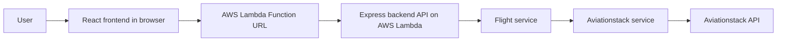
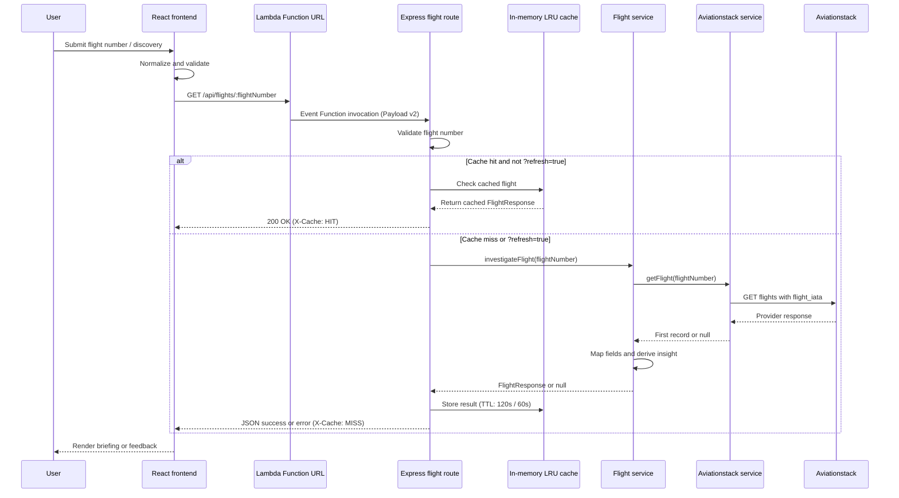

# Flight Detective — High-Level Design

## 1. System boundary

The repository contains two application components:

1. A browser-based React frontend.
2. An Express backend API that calls Aviationstack, deployable as a standalone Express server or an AWS Lambda Event Function.

The frontend does not call Aviationstack directly. The backend owns the
provider integration and the provider credential.

## 2. Components

### Frontend

The Vite-built React 19 application collects flight numbers, maintains
search/loading/result/error state, calls the backend API, and renders an
aviation-grade interface:
- **SearchForm**: Flight number validation, popular corridor suggestion pills, inline ghost corridor hint with Tab auto-fill, and "Surprise Me" real-flight discovery.
- **FlightDetails**:
  - **Vintage Boarding Pass**: Skeuomorphic boarding pass with an interactive perforated ticket stub, procedural audio rip synthesis via Web Audio API, pointer grab/throw physics on desktop, and swipe-down tear gesture with haptic vibration on mobile.
  - **Tactical Cockpit Glass HUD**: Primary Flight Display (PFD) with artificial horizon pitch & roll attitude director, 360-degree tactical airspace radar scope with rotating sweep and ADS-B transponder lock, and dual-unit telemetry instrument cards (m / FL / ft, km/h / knots / Mach, VSI climb/descent, 8-point compass heading, formatted coordinate fix).
  - **AirspaceCanvas**: Interactive HTML5 2D Canvas great-circle geodesic route visualizer with animated aircraft progression.
- **Navigation**: Scroll-aware sticky masthead navigation and responsive multi-column aviation footer.
The frontend source types describe the application API response.

### Express application

`backend/src/app.ts` configures CORS and JSON parsing, mounts the flight
router at `/api/flights`, and defines `GET /api/health`.

### Lambda adapter and local server entrypoints

- `backend/src/lambda.ts`: Adapts the Express app to an AWS Lambda Event Function using `@codegenie/serverless-express`, processing Lambda Function URL HTTP requests (Payload format 2.0). Bundled via esbuild with handler `lambda.handler`.
- `backend/src/server.ts`: Local HTTP development server running via `npm run dev` or `npm start`.

### Flight route

`backend/src/routes/flightRoutes.ts` validates the flight number, provides
flight discovery (`/api/flights/discover`), invokes the flight service,
manages caching and cache bypass (`?refresh=true`), and converts outcomes into
structured HTTP responses.

### Flight service

`backend/src/services/flightService.ts` calls the provider service and
converts provider data to the application-owned `FlightResponse` and `DiscoveryResponse`.
It also derives delay status and summary text.

### Aviationstack service

`backend/src/services/aviationstackService.ts` reads the backend API key from
environment variables, constructs the Aviationstack request, checks the HTTP
response, and returns data records or throws typed errors.

## 3. Request sequence

## 4. API surface

- `GET /api/health`
- `GET /api/flights/:flightNumber` (supports optional `?refresh=true`)
- `GET /api/flights/discover` (supports optional `?refresh=true`)

The flight route accepts flight-number formats matching
`^[A-Z][A-Z0-9]{1,2}\d{1,4}$`.

## 5. Data ownership

- Aviationstack supplies raw flight, airline, route, schedule, delay,
  aircraft, and live-position data.
- Flight Detective owns its response shape, its status names, delay
  categories, delay summary text, and API error codes.
- The frontend consumes the Flight Detective response shape rather than
  provider types.

## 6. Failure behavior

| Failure | Backend result |
| --- | --- |
| Invalid flight number | `400 INVALID_FLIGHT_NUMBER` |
| No provider record | `404 FLIGHT_NOT_FOUND` |
| Upstream timeout | `504 UPSTREAM_TIMEOUT` |
| Upstream rate limit / quota exceeded | `503 PROVIDER_QUOTA_EXCEEDED` |
| Provider response error or malformed body | `502 PROVIDER_ERROR` |
| Upstream auth failure or unhandled exception | `500 FLIGHT_DATA_UNAVAILABLE` |

The frontend distinguishes invalid input and not-found responses; other
request failures are presented as unavailable flight data.

## 7. Runtime and configuration

### Local development
The backend listens on `PORT`, defaulting to `3000`, and reads
`AVIATIONSTACK_API_KEY`. The frontend uses `VITE_API_BASE_URL` as the
optional API origin. During development, the Vite server proxies `/api` to
`http://localhost:3000`.

### AWS Lambda runtime
- **Runtime**: `Node.js 22.x` on `arm64` or `x86_64`. The bundled deployment package is pure JavaScript with zero native C/C++ addons, providing architecture independence across both ARM64 (AWS Graviton) and x86_64.
- **Invocation**: Standard AWS Lambda Event Function via Lambda Function URL (Payload format 2.0).
- **CORS Handling**: Lambda Function URL CORS must remain unconfigured (set to None). Express is the sole CORS handler to prevent duplicate headers.
- **Timeout**: The Lambda function must be configured with a 15-second timeout. Upstream Aviationstack provider fetch timeout remains 8 seconds.
- **Environment variables**: `AVIATIONSTACK_API_KEY` (required), `ALLOWED_ORIGINS`, `FRONTEND_URL`, `RATE_LIMIT_WINDOW_MS`, `RATE_LIMIT_MAX`.
- **Target cost profile**: The AWS Always Free tier covers 1,000,000 requests and 400,000 GB-seconds of compute time per month (e.g. 1,600,000 seconds at 256 MB), with zero base cost for Function URLs.

## 8. Deployment architecture

The backend can be packaged into a deployment ZIP via `npm run build:lambda`
producing `backend/flight-detective-lambda.zip` and deployed to an AWS Lambda
function with a Function URL. The frontend can be hosted on AWS S3 + CloudFront.
Deployment resources are managed outside this repository and are not represented
as infrastructure-as-code here.
