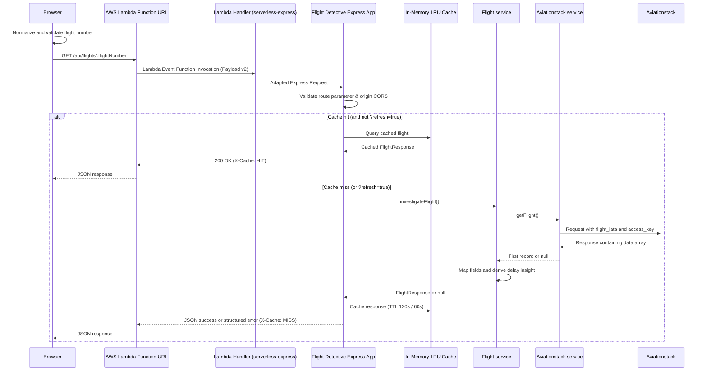

# Flight Detective — System Design

## 1. System shape

The implementation has a static frontend and a request/response backend API
with zero idle cost ($0 out-of-pocket target):

```text
Browser UI → AWS Lambda Function URL → Express Backend (Lambda Event Function) → Aviationstack API
```

The backend is serverless, running inside an AWS Lambda execution environment.
It adapts the Express framework using `@codegenie/serverless-express` for both
serverless Lambda invocations and standard local development.

## 2. Request and trust boundaries

The frontend is responsible for interaction, basic validation, and
rendering. The backend repeats validation and owns the Aviationstack
credential. The provider is accessed through the backend service rather
than directly by browser code.



## 3. Data path

1. The browser submits a flight number from the search form.
2. `App` normalizes and validates the value.
3. `flightApi.getFlight()` performs a `fetch` to
   `/api/flights/:flightNumber`, optionally prefixed by
   `VITE_API_BASE_URL`.
4. The Lambda Function URL receives the HTTPS request and invokes the
   backend Lambda handler with AWS Lambda Payload Format Version 2.0.
5. `@codegenie/serverless-express` maps the event to Express `req` and
   routes to `/api/flights/:flightNumber`.
6. The backend route validates again, checks the in-memory cache, and
   invokes `investigateFlight()`.
7. The Aviationstack service performs the provider request and extracts the
   first record.
8. The flight service maps provider data into `FlightResponse`.
9. The route caches the result in memory and returns JSON; the frontend
   updates its search state and renders either the details or feedback.

## 4. Data transformation ownership

The provider-specific model is defined in
`backend/src/types/aviationstack.ts`. The backend-owned API model is defined
in `backend/src/types/flight.ts`; a corresponding frontend type is in
`frontend/src/types/flight.ts`.

The service translates the supported provider status values, handles both
full and compact airline shapes, maps optional aircraft/live objects, and
derives delay insight from departure delay. No provider object is returned
directly to the UI.

## 5. Runtime failures

| Condition | Application behavior |
| --- | --- |
| Invalid flight number | Backend returns `400 INVALID_FLIGHT_NUMBER`; frontend displays invalid-input feedback. |
| Provider result has no first record | Backend returns `404 FLIGHT_NOT_FOUND`; frontend displays not-found feedback. |
| Provider timeout (>8s) | Backend returns `504 UPSTREAM_TIMEOUT`; frontend displays timeout feedback. |
| Upstream rate limit or quota exceeded | Backend returns `503 PROVIDER_QUOTA_EXCEEDED`; frontend displays quota feedback. |
| Upstream network or response error | Backend returns `502 PROVIDER_ERROR`; frontend displays provider error feedback. |
| Missing API key or internal exception | Backend returns `500 FLIGHT_DATA_UNAVAILABLE`; frontend displays unavailable feedback. |
| Search rate limit exceeded | Backend returns `429 RATE_LIMIT_EXCEEDED`; frontend displays rate limit feedback. |
| Unapproved CORS origin | Backend returns `403 CORS_FORBIDDEN`. |
| Aircraft or live provider object is `null` | API returns `null` for that optional object; the UI omits its corresponding details. |

Provider non-OK status and response body are logged by the provider
service with secret redaction. The API key and secret-bearing URLs are never
logged or included in responses.

## 6. Configuration and local development

- Local server: `PORT` defaults to `3000` via `src/server.ts`.
- AWS Lambda: Event function handler in `src/lambda.ts` (`lambda.handler`).
- Provider key: `AVIATIONSTACK_API_KEY` supplied via Lambda environment variables.
- CORS origins: `ALLOWED_ORIGINS` and `FRONTEND_URL`.
- Frontend `VITE_API_BASE_URL` supplies an optional API origin (e.g., the Lambda Function URL).
- Vite development configuration proxies `/api` to `http://localhost:3000`.

## 7. Lambda execution environment characteristics & trade-offs

- **Cost Target ($0 out-of-pocket)**: Lambda Event Functions with Function URLs incur zero cost when idle. The AWS Always Free tier covers 1,000,000 requests and 400,000 GB-seconds of compute time per month (e.g. 1,600,000 seconds at 256 MB), with zero base cost for Function URLs.
- **In-Memory Cache**: `flightCache` and `discoveryCache` live in container memory. Invocations routed to a warm microVM hit the cache; cold starts initialize empty caches; concurrent requests on separate microVMs maintain independent caches. No external paid caching services (Redis/ElastiCache) are introduced.
- **Rate Limiting Scope**: `express-rate-limit` tracks counts in memory per container. In multi-instance concurrent bursts, each container enforces its own counter.
- **Reserved Concurrency**: If AWS Reserved Concurrency is configured on the Lambda function, it sets an upper limit on the number of concurrently executing Lambda instances (microVMs), not requests per minute, and must not be treated as a global rate limiter. Invocations arriving when all reserved environments are busy receive HTTP 429.
- **CORS Handling**: Lambda Function URL CORS must remain unconfigured (set to None) in AWS. Express is the sole CORS handler to avoid duplicate headers.
- **Timeout Configuration**: The Lambda function must be configured with a 15-second timeout. Upstream Aviationstack provider fetch timeout remains 8 seconds (via `AbortSignal.timeout(8000)`).
- **Architecture**: The bundled deployment package is pure JavaScript with zero native C/C++ addons, providing architecture independence across both ARM64 (AWS Graviton) and x86_64.
- **Cold Starts**: Initial invocations after an idle period take ~200–500ms to spin up the Node.js container; warm invocations execute within milliseconds.

## 8. Deployment architecture

The backend is built into a self-contained ZIP archive (~290 KB) using:

```powershell
npm run build:lambda
# or
npm run package
```

The ZIP package contains a single, self-contained `lambda.js` file bundled with `esbuild` (zero `node_modules` dependencies) and root shims at `backend/flight-detective-lambda.zip`. It deploys to an AWS Lambda function (`Node.js 22.x`, arm64 or x86_64) equipped with a Lambda Function URL with auth type `NONE`.
