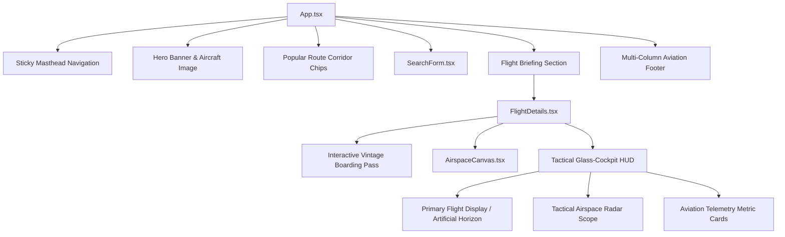
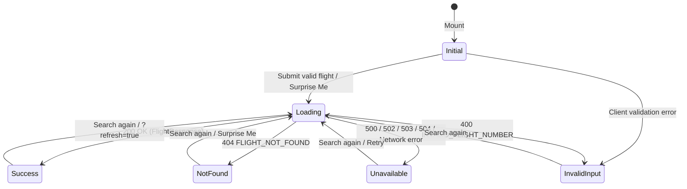

# Flight Detective — Frontend UI Architecture Specs

The Flight Detective frontend is a high-performance React 19 application built with TypeScript and Vite. It provides an aviation-grade interface for looking up commercial flights, exploring high-traffic corridors, tracking real-time ADS-B telemetry, and visualizing flight paths.

---

## 1. UI Architecture & Component Hierarchy

```text
src/
├── assets/
│   └── hero-aircraft.jpg              # High-resolution aviation hero banner
├── components/
│   ├── AirspaceCanvas.tsx             # Interactive HTML5 Canvas geodesic route visualizer
│   ├── FlightDetails.tsx              # Flight briefing: vintage boarding pass & tactical cockpit HUD
│   ├── FlightDetails.test.tsx         # Boarding pass ticket tear interaction test suite
│   ├── SearchForm.tsx                 # Labeled search input, corridor suggestions & Surprise Me
│   └── SearchForm.test.tsx            # SearchForm component test suite
├── services/
│   ├── flightApi.ts                   # Fetch API client, discovery loader & custom error classes
│   └── flightApi.test.ts              # API client unit tests
├── test/
│   └── setup.ts                       # Test setup & polyfills (Canvas, Web Audio, ResizeObserver)
├── types/
│   └── flight.ts                      # Frontend domain types matching backend API contract
├── App.css                            # Aviation design tokens, cockpit instruments & boarding pass styles
├── App.test.tsx                       # Full application integration test suite
├── App.tsx                            # Root application controller & state machine
├── index.css                          # Base reset, typography & ambient glow backgrounds
└── main.tsx                           # StrictMode entrypoint & React DOM root
```

### Component Hierarchy



---

## 2. Key UI Features & Implementation Specs

### 2.1 Interactive Vintage Boarding Pass (`FlightDetails.tsx`)

A skeuomorphic, retro-styled airline boarding pass featuring:
- **Interactive Ticket Perforation & Tear Simulation**:
  - **Desktop Pointer Grab & Throw**: Click, grab, or drag the perforated stub divider (`.ticket-perf-divider`) across threshold physics to cleanly detach the boarding stub.
  - **Mobile Swipe-Down Gesture**: Pointer capture listener tracking vertical drag (`mobileDragY`). Pulling down $\ge 20\text{px}$ cleanly tears the mobile stub.
  - **Web Audio API Sound Synthesis**: Synthesizes authentic white noise paper rip transients (`initAudio()`, `ripNoise()`, `thump()`) without external audio asset dependencies.
  - **Mobile Haptic Feedback**: Triggers device vibration pattern (`navigator.vibrate(25)`) upon tear completion.
  - **Ticket Actions**: Allows folding detached stubs into flying paper airplanes (`handlePaperAirplane()`), crumpling into rolling paper balls (`handleCrumple()`), or auto-dispensing fresh replacement passes.
- **Flight Info Layout**:
  - Departure and arrival airport IATA codes, cities, terminals, gates, scheduled/estimated/actual local timestamps.
  - Dynamic status badge (`scheduled`, `in_flight`, `landed`, `cancelled`, `incident`, `diverted`).
  - Flight delay insight badge (`on_time`, `minor_delay`, `delayed`, `significant_delay`).
  - Barcode and flight transponder readout.

### 2.2 Great-Circle Geodesic Airspace Canvas (`AirspaceCanvas.tsx`)

An interactive HTML5 2D Canvas route visualizer:
- **Geodesic Path Calculation**: Computes spherical great-circle coordinates between origin and destination airports.
- **Curved Arc Rendering**: Draws smooth quadratic/cubic Bezier approximations of geodesic trajectories with glowing neon gradient strokes.
- **Live Aircraft Tracking**: Renders animated aircraft position along the arc matching elapsed flight progress or live transponder fixes.
- **Dual View Toggle**: Allows seamless switching between the Boarding Pass view and the full Geodesic Airspace Canvas view via tab controls.

### 2.3 Tactical Cockpit Glass HUD (`FlightDetails.tsx`)

An authentic avionics glass-cockpit instrument cluster:
1. **Primary Flight Display (PFD)**:
   - Artificial horizon with dynamic pitch ladder markings ($\pm 10^\circ, \pm 20^\circ$) and roll bank angle index.
   - Visual division between sky (`--pfd-sky`) and ground (`--pfd-ground`).
   - Integrated aircraft attitude reticle indicator.
2. **Tactical Airspace Radar Scope**:
   - 360-degree rotating radar sweep arm with glowing radial gradient sweep beam.
   - Concentric range rings calibrated to 50NM and 100NM.
   - Crosshair reticles with range distance labels.
   - ADS-B transponder lock status pill with pulsating green LED.
   - Live target blip pulse animations rendered from transponder coordinates.
3. **Dual-Unit Telemetry Instruments**:
   - **Altitude**: Meters + Flight Level (`FL380`) + Feet (`38,000 ft`).
   - **Ground Speed**: km/h + Knots (`450 kts`) + Mach number (`Mach 0.78`).
   - **Vertical Speed**: Numerical rate of climb/descent + status indicator (`Climbing`, `Level Flight`, `Descending`).
   - **Heading**: Compass degrees ($0^\circ - 360^\circ$) + 8-point cardinal direction (`ENE`, `SSW`, etc.).
   - **Coordinates**: Decimal degrees + formatted DMS hemisphere transponder fix (`40°38'N 73°46'W`).

### 2.4 Search Experience & Corridor Suggestions (`SearchForm.tsx`)

- **Instant Corridor Pills**: Quick-select buttons for high-volume routes (`JFK → LHR`, `SFO → HND`, `LAX → NRT`, etc.) immediately investigating real active flights.
- **Ghost Corridor Hint & Tab Auto-Fill**:
  - Typing a partial flight number or matching prefix renders an inline ghost text suggestion.
  - Pressing the <kbd>Tab</kbd> key auto-completes the input with the suggested flight code.
- **Live Flight Discovery ("Surprise Me")**:
  - One-click trigger querying `/api/flights/discover`.
  - Randomly selects an active airborne flight and automatically loads its briefing.
- **Input Normalization & Client Validation**:
  - Enforces `^[A-Z][A-Z0-9]{1,2}\d{1,4}$`.
  - Automatically uppercases user input and trims whitespace.
- **Cache Bypass Refresh**:
  - Dedicated refresh action passes `?refresh=true` to the backend to force fresh upstream data.

### 2.5 Smart Masthead Navigation & Footer (`App.tsx`)

- **Scroll-Aware Auto-Hide**: Sticky header that auto-hides when scrolling down past $80\text{px}$ and smoothly reveals when scrolling up by $\ge 12\text{px}$.
- **Anchor Navigation**: Smooth scroll shortcuts to `#search-section` and `#results-section`.
- **Multi-Column Aviation Footer**: Responsive grid with Quick Search links, Popular Corridors, Tech Stack information, and author links.

---

## 3. State Management & API Contract

### State Flow



### Discriminated Union States (`App.tsx`)

```typescript
type SearchState =
  | { status: 'initial' }
  | { status: 'loading'; flightNumber: string }
  | { status: 'success'; flight: FlightResponse }
  | { status: 'not_found'; flightNumber: string }
  | { status: 'invalid_input'; message: string }
  | { status: 'unavailable'; message: string };
```

---

## 4. Design Tokens & Styling Architecture

The application uses CSS custom properties defined in `src/App.css` and `src/index.css`:

```css
:root {
  --bg-primary: #0b111e;
  --bg-secondary: #101a2e;
  --bg-tertiary: #162238;
  --accent-sky: #38bdf8;
  --accent-sky-rgb: 56, 189, 248;
  --cockpit-amber: #f59e0b;
  --amber-radar: #00ff66;
  --pfd-sky: #1d4ed8;
  --pfd-ground: #854d0e;
  --text-main: #f1f5f9;
  --text-muted: #94a3b8;
  --border-subtle: rgba(255, 255, 255, 0.08);
  --font-mono: 'JetBrains Mono', 'Fira Code', monospace;
}
```

- **Responsive Viewports**: Tested across mobile ($320\text{px} - 480\text{px}$), tablet ($768\text{px} - 1024\text{px}$), and desktop ($\ge 1280\text{px}$).
- **Accessibility**: High-contrast ratios, complete ARIA landmark regions, and `@media (prefers-reduced-motion: reduce)` support.

---

## 5. Development & Testing Commands

### Local Development

```powershell
cd frontend
npm install
npm run dev
```

### Unit & Component Tests

```powershell
npm test
```
Runs 38 tests across 4 test suites with Vitest and React Testing Library:
- `src/App.test.tsx`: Search lifecycle, empty states, Surprise Me flow, corridor clicks, and cache bypass.
- `src/components/FlightDetails.test.tsx`: Boarding pass rendering, perforation tear physics, keyboard tear, airplane and crumple animations.
- `src/components/SearchForm.test.tsx`: Input validation, form submission, and corridor interactions.
- `src/services/flightApi.test.ts`: URL construction, query parameters, and error mapping.

### End-to-End (E2E) Browser Tests

```powershell
npm run test:e2e
```
Runs Playwright E2E browser tests:
- `e2e/flight-search.spec.ts`: Desktop search, loading states, flight briefing rendering, and error flows.
- `e2e/mobile-layout.spec.ts`: Mobile viewport layout, mobile ticket tear swipe gestures, and responsive masthead behavior.

### Production Build & Linting

```powershell
npm run lint
npm run build
```
Typechecks with `tsc -b` and bundles with Vite to `frontend/dist/`.

---

## 6. Related Architecture Documentation

- [Root README](../README.md) — Full repository overview, backend architecture, and setup instructions.
- [V2 Overview](../docs/V2-OVERVIEW.md) — Comprehensive V2 specifications, features, and platform evolution.
- [V1 Overview](../docs/V1-OVERVIEW.md) — Baseline requirements and initial release architecture.
- [High-Level Design (HLD)](../docs/HLD.md) — System topology, boundary definition, and sequence flows.
- [Low-Level Design (LLD)](../docs/LLD.md) — Detailed frontend and backend module implementations.
- [System Design](../docs/SYSTEM-DESIGN.md) — Architectural patterns, request flows, and zero-cost serverless trade-offs.
